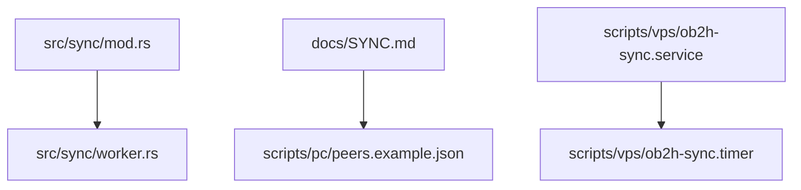
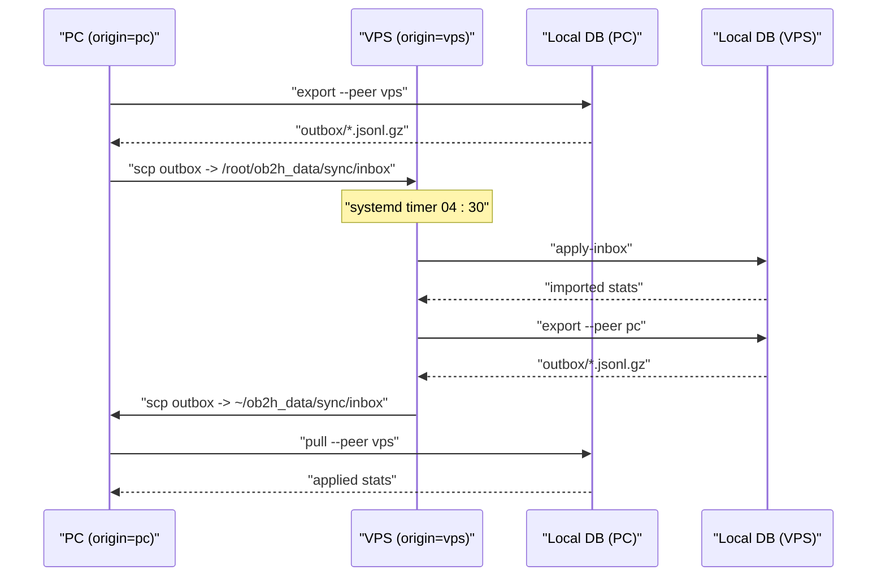
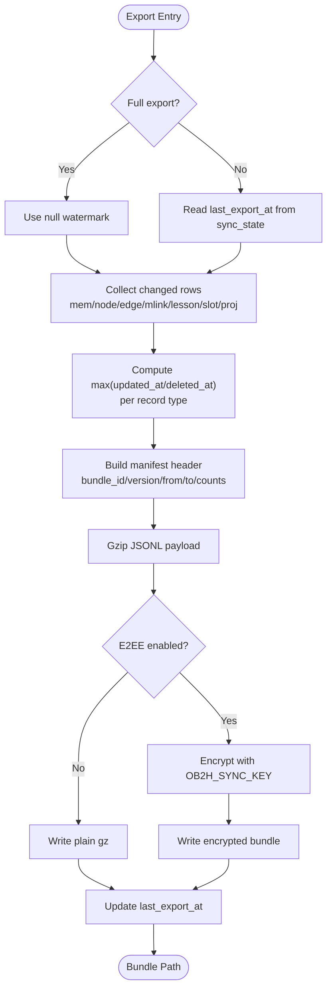
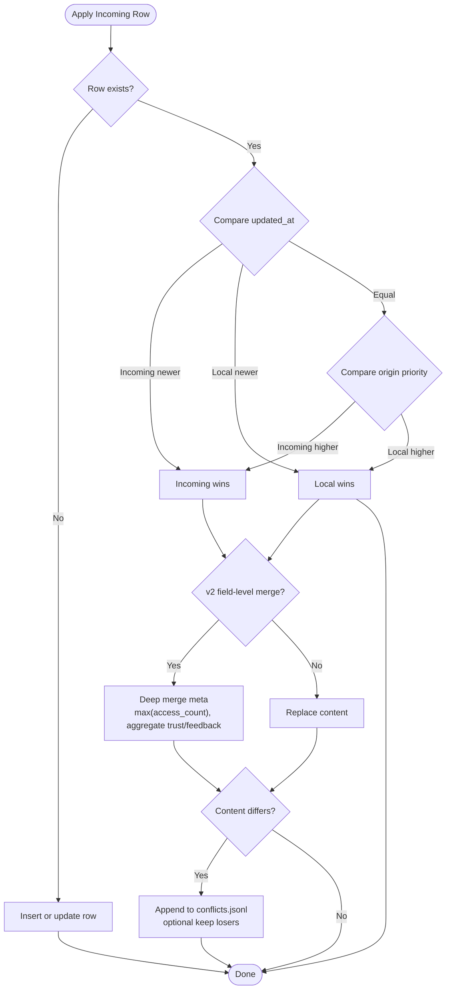
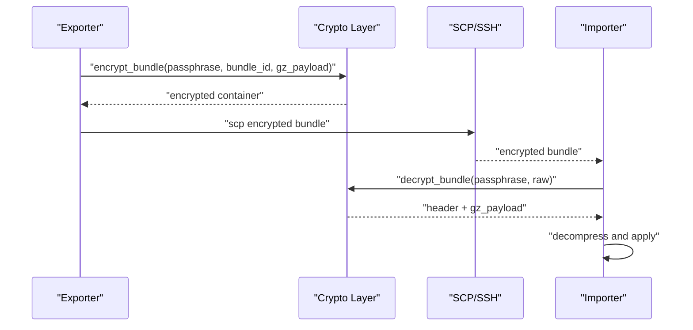
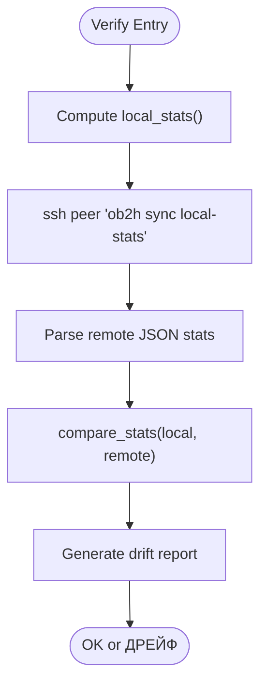
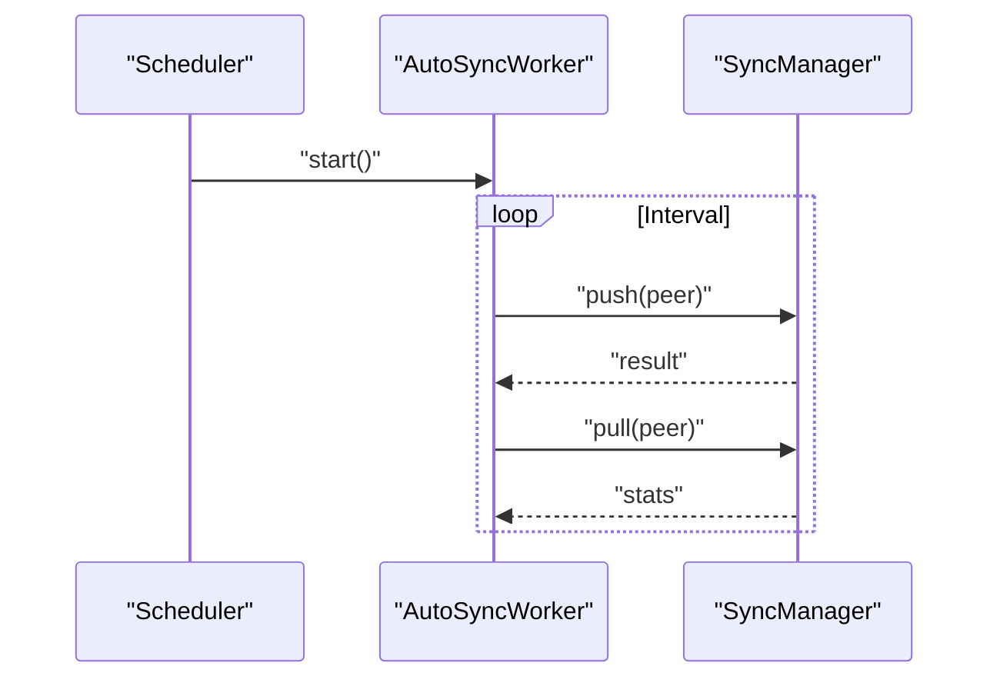
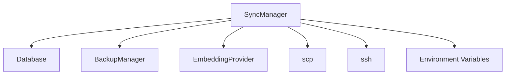

# Sync System

<cite>
**Referenced Files in This Document**
- [SYNC.md](file://docs/SYNC.md)
- [mod.rs](file://src/sync/mod.rs)
- [worker.rs](file://src/sync/worker.rs)
- [peers.example.json](file://scripts/pc/peers.example.json)
- [ob2h-sync.service](file://scripts/vps/ob2h-sync.service)
- [ob2h-sync.timer](file://scripts/vps/ob2h-sync.timer)
</cite>

## Table of Contents
1. [Introduction](#introduction)
2. [Project Structure](#project-structure)
3. [Core Components](#core-components)
4. [Architecture Overview](#architecture-overview)
5. [Detailed Component Analysis](#detailed-component-analysis)
6. [Dependency Analysis](#dependency-analysis)
7. [Performance Considerations](#performance-considerations)
8. [Troubleshooting Guide](#troubleshooting-guide)
9. [Conclusion](#conclusion)

## Introduction
This document explains the cross-machine synchronization sub-feature that keeps two ob2h instances consistent without cloud services or open ports. It focuses on secure data transfer, delta bundles, field-level merge conflict resolution with journaling and tracking, end-to-end encryption for bundle payloads, peer configuration, idempotent operations, automatic backup before import, drift verification, manual mode when SSH is unavailable, and operational examples.

The sync system transfers only changed fields between machines via SSH, while keeping live SQLite databases local. Each machine owns its own database; synchronization happens through file-based bundles placed in `data/sync/inbox` and `data/sync/outbox`.

**Section sources**
- [SYNC.md:1-30](file://docs/SYNC.md#L1-L30)
- [SYNC.md:32-67](file://docs/SYNC.md#L32-L67)

## Project Structure
The sync feature lives under `src/sync`, with supporting scripts for Windows scheduling and Linux systemd automation. Documentation and example peer configuration are provided separately.

**Diagram sources**
- [mod.rs:1-30](file://src/sync/mod.rs#L1-L30)
- [worker.rs:1-13](file://src/sync/worker.rs#L1-L13)
- [peers.example.json:1-14](file://scripts/pc/peers.example.json#L1-L14)
- [ob2h-sync.service:1-10](file://scripts/vps/ob2h-sync.service#L1-L10)
- [ob2h-sync.timer:1-10](file://scripts/vps/ob2h-sync.timer#L1-L10)

**Section sources**
- [mod.rs:1-30](file://src/sync/mod.rs#L1-L30)
- [worker.rs:1-13](file://src/sync/worker.rs#L1-L13)
- [peers.example.json:1-14](file://scripts/pc/peers.example.json#L1-L14)
- [ob2h-sync.service:1-10](file://scripts/vps/ob2h-sync.service#L1-L10)
- [ob2h-sync.timer:1-10](file://scripts/vps/ob2h-sync.timer#L1-L10)

## Core Components
- **SyncManager**: Central orchestrator for export, import, push/pull, inbox application, scheduled runs, statistics, drift verification, and status reporting.
- **NodeConfig**: Loads `data/sync/peers.json`, defines origin, priority tie-break order, peers, and whether to run sync after auto-dream.
- **PeerConfig**: Describes a remote peer’s transport method, host, optional SSH port, remote directories, optional remote binary path, and optional remote data directory for drift checks.
- **AutoSyncWorker**: Background worker that periodically pushes and pulls all SSH-enabled peers.
- **ImportStats**: Tracks applied rows, conflicts lost, conflicts journaled, skipped references, and idempotency state.

Key responsibilities:
- Export delta bundles based on per-peer watermarks.
- Import bundles idempotently with automatic backup.
- Resolve content conflicts using later-write-wins plus origin priority.
- Journal content conflicts and optionally preserve losing versions.
- Encrypt bundle payloads end-to-end when configured.
- Verify drift without transferring data by comparing deterministic checksums.

**Section sources**
- [mod.rs:31-125](file://src/sync/mod.rs#L31-L125)
- [mod.rs:194-247](file://src/sync/mod.rs#L194-L247)
- [worker.rs:9-22](file://src/sync/worker.rs#L9-L22)

## Architecture Overview
The sync architecture uses file-based bundles over SSH. The PC initiates push/pull; the VPS applies incoming bundles and prepares outgoing bundles on schedule. Bundles contain only changed rows since the last watermark.

**Diagram sources**
- [SYNC.md:32-57](file://docs/SYNC.md#L32-L57)
- [mod.rs:247-469](file://src/sync/mod.rs#L247-L469)
- [mod.rs:1500-1574](file://src/sync/mod.rs#L1500-L1574)
- [ob2h-sync.service:1-10](file://scripts/vps/ob2h-sync.service#L1-L10)
- [ob2h-sync.timer:1-10](file://scripts/vps/ob2h-sync.timer#L1-L10)

## Detailed Component Analysis

### Delta Bundle Format
A bundle is a gzip-compressed JSON Lines file. The first line is a manifest header; subsequent lines are typed records for memories, graph nodes, graph edges, memory links, lessons, slots, and projects. The format supports version 2, which includes trust, feedback timestamps, memory links, and field-level merge semantics.

Important aspects:
- Watermark-based deltas: export uses `last_export_at` per peer unless `--full` is requested.
- Header fields include `bundle_id`, `origin`, `peer`, `created_at`, `version`, `full`, `from`, `to`, and counts per record type.
- Tombstones: deleted rows are represented with `deleted_at`, enabling soft deletes across peers.
- Embeddings: stored as hex strings; missing embeddings can be recomputed locally during import.

**Diagram sources**
- [mod.rs:247-469](file://src/sync/mod.rs#L247-L469)

**Section sources**
- [mod.rs:247-469](file://src/sync/mod.rs#L247-L469)
- [SYNC.md:257-276](file://docs/SYNC.md#L257-L276)

### Field-Level Merge Conflict Resolution and Journaling
Conflict resolution follows later-write-wins (LWW) with tie-breaking by origin priority defined in `peers.json`. For v2 bundles, merging is performed at the field level rather than silently replacing entire rows.

Rules:
- Content conflicts: winner is determined by `updated_at`; if equal, lower index in `priority` wins.
- Metadata merge: deep merge of `meta`, `access_count` takes maximum of local and incoming, trust and feedback metrics are aggregated.
- Tombstones: deletions propagate; re-saving the same key resurrects the row.
- Idempotency: importing the same `bundle_id` again is a no-op.
- Automatic backup: a snapshot is created before applying each new bundle.
- Conflict journaling: content conflicts are appended to `data/sync/conflicts.jsonl`; setting `OB2H_SYNC_KEEP_LOSERS=1` preserves losing versions in `meta.conflict_versions`.

**Diagram sources**
- [mod.rs:747-754](file://src/sync/mod.rs#L747-L754)
- [mod.rs:756-800](file://src/sync/mod.rs#L756-L800)
- [mod.rs:541-547](file://src/sync/mod.rs#L541-L547)
- [mod.rs:702-724](file://src/sync/mod.rs#L702-L724)

**Section sources**
- [mod.rs:541-547](file://src/sync/mod.rs#L541-L547)
- [mod.rs:747-754](file://src/sync/mod.rs#L747-L754)
- [mod.rs:756-800](file://src/sync/mod.rs#L756-L800)
- [mod.rs:702-724](file://src/sync/mod.rs#L702-L724)
- [SYNC.md:58-67](file://docs/SYNC.md#L58-L67)
- [SYNC.md:257-276](file://docs/SYNC.md#L257-L276)

### End-to-End AES-GCM Encryption for Secure Data Transmission
Bundles can be encrypted end-to-end using a passphrase supplied via environment variable `OB2H_SYNC_KEY`. When enabled, exported bundles use an encrypted container format with a magic header, KDF parameters, salt, and ciphertext. Decryption requires the same passphrase.

Security characteristics:
- Container starts with a known magic marker.
- Header contains version, KDF algorithm, cost parameters, salt, and bundle ID.
- Payload is encrypted with derived keys; header integrity is protected via associated authenticated data.
- If the environment variable is not set, bundles remain unencrypted.
- Import fails gracefully if the bundle is encrypted but the passphrase is missing.

**Diagram sources**
- [mod.rs:127-192](file://src/sync/mod.rs#L127-L192)
- [mod.rs:441-448](file://src/sync/mod.rs#L441-L448)
- [mod.rs:512-522](file://src/sync/mod.rs#L512-L522)

**Section sources**
- [mod.rs:127-192](file://src/sync/mod.rs#L127-L192)
- [mod.rs:441-448](file://src/sync/mod.rs#L441-L448)
- [mod.rs:512-522](file://src/sync/mod.rs#L512-L522)

### Peer Configuration System
Peer configuration is loaded from `data/sync/peers.json`. It defines the local node identity, priority ordering, peer definitions, and automatic sync behavior.

Fields:
- `origin`: local machine identifier used for LWW tie-breaking and bundle naming.
- `priority`: ordered list determining tie-break precedence for conflicting updates.
- `after_dream`: enables automatic push/pull of all SSH peers after each auto-dream.
- `peers.<name>`: peer-specific settings including transport method, host, optional SSH port, remote directories, optional remote binary path, and optional remote data directory for drift checks.

Example peer configuration:
- See [peers.example.json:1-14](file://scripts/pc/peers.example.json#L1-L14).

Operational notes:
- Missing or malformed `peers.json` disables sync until fixed, but core memory/graph functionality remains unaffected.
- Manual mode (`method: "manual"`) allows moving bundles manually instead of using SSH.

**Section sources**
- [mod.rs:31-105](file://src/sync/mod.rs#L31-L105)
- [mod.rs:204-233](file://src/sync/mod.rs#L204-L233)
- [peers.example.json:1-14](file://scripts/pc/peers.example.json#L1-L14)
- [SYNC.md:100-137](file://docs/SYNC.md#L100-L137)

### Idempotent Operations, Automatic Backup Before Import, and Drift Verification
Idempotency:
- Imported bundles are tracked by `bundle_id` in `sync_state.applied_bundles`. Re-importing the same bundle is a no-op.
- Applied bundle list is capped to prevent unbounded growth.

Automatic backup:
- Before applying a new bundle, the system attempts to create a backup snapshot. Failure is logged but does not abort import.

Drift verification:
- `local-stats` computes deterministic checksums over key+timestamp aggregates for memories, memory links, lessons, and slots, along with counts and average trust.
- `verify` runs remotely via SSH to collect peer stats and compares them, producing a human-readable drift report.

**Diagram sources**
- [mod.rs:1599-1719](file://src/sync/mod.rs#L1599-L1719)
- [mod.rs:1721-1800](file://src/sync/mod.rs#L1721-L1800)

**Section sources**
- [mod.rs:549-560](file://src/sync/mod.rs#L549-L560)
- [mod.rs:664-686](file://src/sync/mod.rs#L664-L686)
- [mod.rs:1599-1719](file://src/sync/mod.rs#L1599-L1719)
- [mod.rs:1721-1800](file://src/sync/mod.rs#L1721-L1800)
- [SYNC.md:202-210](file://docs/SYNC.md#L202-L210)

### Manual Mode When Direct SSH Is Unavailable
When direct SSH access is not possible, configure peers with `method: "manual"`. In this mode:
- Use `ob2h sync export --peer <name>` to produce bundles in `data/sync/outbox`.
- Transfer bundles using any mechanism you control (Syncthing, private Git, USB).
- Place received bundles into `data/sync/inbox` and run `ob2h sync apply-inbox`.

Manual mode avoids network assumptions and keeps bundle movement explicit.

**Section sources**
- [mod.rs:1538-1553](file://src/sync/mod.rs#L1538-L1553)
- [mod.rs:1557-1574](file://src/sync/mod.rs#L1557-L1574)
- [SYNC.md:177-188](file://docs/SYNC.md#L177-L188)

### Automated Scheduling and Background Worker
Automated synchronization can be driven by:
- `after_dream: true` in `peers.json`, which triggers push/pull of all SSH peers after each auto-dream.
- A background worker (`AutoSyncWorker`) that periodically runs push/pull for SSH peers.
- System-level scheduling:
  - Windows: PowerShell task registration and execution via `scripts/pc/sync-task.ps1`.
  - Linux: systemd timer invoking `ob2h sync apply-inbox && ob2h sync export --peer pc`.

**Diagram sources**
- [worker.rs:24-63](file://src/sync/worker.rs#L24-L63)
- [mod.rs:1576-1597](file://src/sync/mod.rs#L1576-L1597)
- [ob2h-sync.service:1-10](file://scripts/vps/ob2h-sync.service#L1-L10)
- [ob2h-sync.timer:1-10](file://scripts/vps/ob2h-sync.timer#L1-L10)

**Section sources**
- [worker.rs:9-63](file://src/sync/worker.rs#L9-L63)
- [mod.rs:1576-1597](file://src/sync/mod.rs#L1576-L1597)
- [SYNC.md:143-175](file://docs/SYNC.md#L143-L175)

### Concrete Examples

#### Peer Configuration Example
- PC-side example: see [peers.example.json:1-14](file://scripts/pc/peers.example.json#L1-L14).
- VPS-side minimal config: see [SYNC.md:130-137](file://docs/SYNC.md#L130-L137).

#### Manual Sync Operations
- PC: export and push to VPS, then pull and apply.
- VPS: apply inbox and export back to PC.
- Status and verification commands are documented in [SYNC.md:190-201](file://docs/SYNC.md#L190-L201).

#### Automated Scheduling
- VPS systemd timer and service: see [ob2h-sync.timer:1-10](file://scripts/vps/ob2h-sync.timer#L1-L10) and [ob2h-sync.service:1-10](file://scripts/vps/ob2h-sync.service#L1-L10).
- PC PowerShell scheduling: see [SYNC.md:154-161](file://docs/SYNC.md#L154-L161).

**Section sources**
- [peers.example.json:1-14](file://scripts/pc/peers.example.json#L1-L14)
- [SYNC.md:130-137](file://docs/SYNC.md#L130-L137)
- [SYNC.md:190-201](file://docs/SYNC.md#L190-L201)
- [SYNC.md:154-161](file://docs/SYNC.md#L154-L161)
- [ob2h-sync.timer:1-10](file://scripts/vps/ob2h-sync.timer#L1-L10)
- [ob2h-sync.service:1-10](file://scripts/vps/ob2h-sync.service#L1-L10)

## Dependency Analysis
The sync subsystem depends on:
- Database layer for reading/writing rows and sync state.
- Backup manager for pre-import snapshots.
- Embedding provider for recomputing missing embeddings during import.
- External tools: `scp` and `ssh` for transport and remote stats collection.
- Environment variables: `OB2H_SYNC_KEY` for E2EE, `OB2H_SYNC_KEEP_LOSERS` for preserving losing conflict versions.

**Diagram sources**
- [mod.rs:194-247](file://src/sync/mod.rs#L194-L247)
- [mod.rs:570-625](file://src/sync/mod.rs#L570-L625)
- [mod.rs:1519-1530](file://src/sync/mod.rs#L1519-L1530)
- [mod.rs:1736-1755](file://src/sync/mod.rs#L1736-L1755)

**Section sources**
- [mod.rs:194-247](file://src/sync/mod.rs#L194-L247)
- [mod.rs:570-625](file://src/sync/mod.rs#L570-L625)
- [mod.rs:1519-1530](file://src/sync/mod.rs#L1519-L1530)
- [mod.rs:1736-1755](file://src/sync/mod.rs#L1736-L1755)

## Performance Considerations
- Delta bundles reduce transferred data by exporting only rows changed since the last watermark.
- Full exports are available via `--full` for periodic reconciliation or recovery scenarios.
- Embedding recomputation occurs only for missing embeddings during import, avoiding unnecessary computation.
- Applied bundle list is capped to limit metadata growth.
- Drift verification uses deterministic checksums computed in SQL, minimizing data movement and CPU overhead.

[No sources needed since this section provides general guidance]

## Troubleshooting Guide
Common issues and resolutions:
- SCP destination errors: ensure the remote `push_to` directory exists.
- Peer not found: verify peer name and existence of `data/sync/peers.json`.
- Silent no-ops: confirm `after_dream` is enabled or scheduler is running.
- Lost LWW conflicts: check `conflicts_проиграно=N` in import output; it indicates older local edits were overwritten.
- Flapping facts: ensure clocks are synchronized via NTP so `updated_at` comparisons are reliable.
- Bundle not applied repeatedly: expected due to idempotency by `bundle_id`.
- Sync disabled due to bad config: fix JSON parsing errors in `peers.json`.

Additional diagnostics:
- Use `ob2h sync status` to inspect origins, priorities, watermarks, bundle counts, and cumulative LWW losses.
- Use `ob2h sync verify [--peer <name>]` to detect drift without transferring data.

**Section sources**
- [SYNC.md:211-221](file://docs/SYNC.md#L211-L221)
- [SYNC.md:190-201](file://docs/SYNC.md#L190-L201)
- [mod.rs:1802-1880](file://src/sync/mod.rs#L1802-L1880)

## Conclusion
The sync system provides robust, secure, and efficient cross-machine synchronization for ob2h instances. It leverages delta bundles, field-level merges with conflict journaling, optional end-to-end encryption, idempotent imports with automatic backups, and drift verification. Operational flexibility is achieved through SSH automation, manual mode, and background workers, making it suitable for diverse environments ranging from home PCs to headless servers.

[No sources needed since this section summarizes without analyzing specific files]